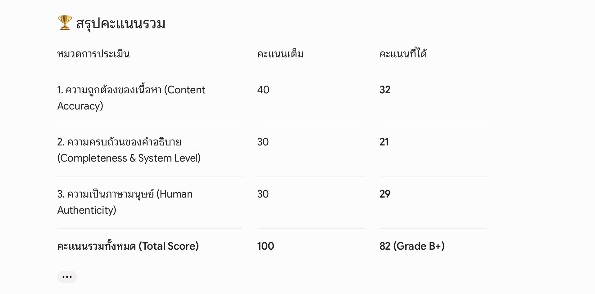
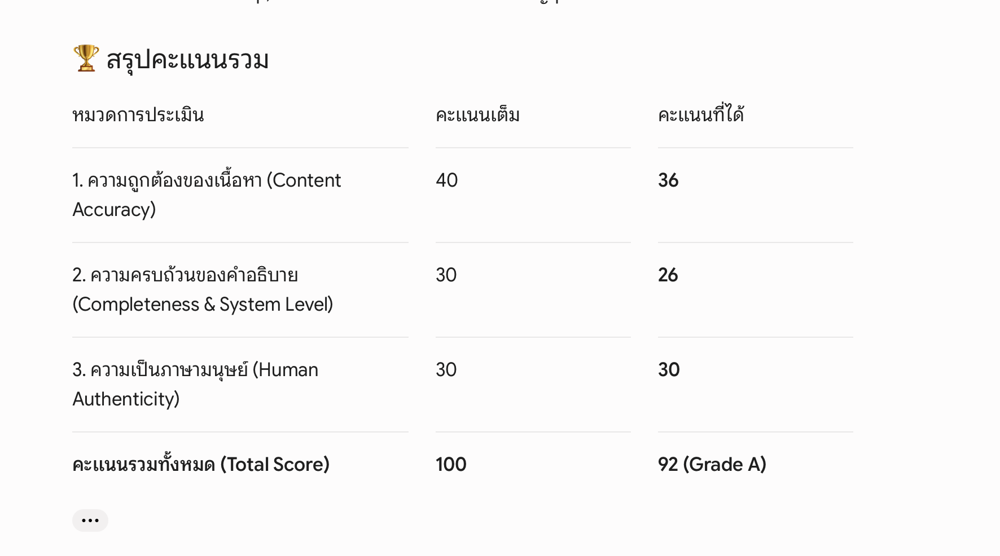
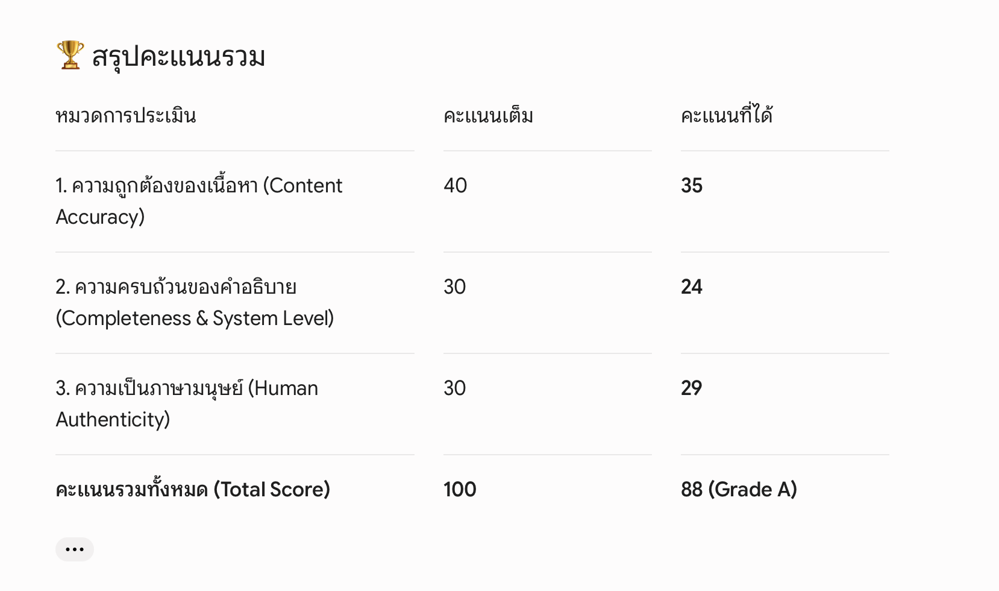

 หมวด A — ข้อที่ 1: Introduction to IoT
คำถาม:  
“อธิบายว่า Internet of Things (IoT) คืออะไร และยกตัวอย่างระบบ IoT ที่พบในชีวิตประจำวัน พร้อมอธิบายว่าทำไมระบบนั้นจึงถือเป็น IoT”
 
คำตอบ 
ตัวอย่าง: แอร์อัจฉริยะ Smart Air Conditioner
ทำไมถึงเป็น IoT?
มีเน็ตในตัว ต่อ Wi-Fi บ้านได้
สั่งจากไหนก็ได้ นั่งอยู่บนรถเมล์ ก็เปิดแอร์ที่บ้านผ่านแอปในมือถือรอไว้ได้
ทำงานเองได้ ตั้งค่าให้มันเปิดเองอัตโนมัติเมื่อเราขับรถใกล้จะถึงบ้าน
แค่อุปกรณ์ทั่วไปที่ต่ออินเทอร์เน็ตได้และสั่งงานผ่านมือถือหรือทำงานเองได้ก็ถือว่าเป็นIoT 

คะแนนจาก AI TA 

หมวด B — ข้อที่ 1: Internet Layer IoT Network Technologies
คำถาม:  
“อธิบายเทคโนโลยีการสื่อสารในชั้น Internet Layer ที่ใช้ในระบบ IoT เช่น IPv6, 6LoWPAN, RPL  
พร้อมอธิบายว่าทำไมเทคโนโลยีเหล่านี้จึงเหมาะกับอุปกรณ์ IoT ที่มีข้อจำกัดด้านพลังงานและแบนด์วิธ”

คำตอบ
3 เทคโนโลยีในชั้น Internet Layer ของ IoT
IPv6 ตัวแจกบ้านเลขที่
ทำหน้าที่แจก IP Address ให้ระบบ IoT เพราะ IPv4 เลขหมดแล้ว ทำให้บอร์ดหรือเซนเซอร์ทุกตัวมี "เลขประจำตัว" บนโลกอินเทอร์เน็ต
6LoWPAN ตัวย่อขนาดข้อมูล
ทำหน้าที่ "ย่อ/บีบอัด" หัวข้อความของ IPv6 ให้เล็กลง เพื่อให้ส่งผ่านคลื่นวิทยุแรงดันต่ำได้ ไม่กินแถบสัญญาณ Bandwidth
RPL ตัวหาทางส่ง
เป็นระบบเลือกเส้นทางส่งข้อมูล Routing มันจะช่วยหาทางส่งข้อมูลที่สั้นที่สุด อ้อมน้อยที่สุด และประหยัดไฟที่สุดให้เซนเซอร์
ทำไมถึงเหมาะกับ IoT ที่แบตน้อย/เน็ตช้า?
กินไฟน้อยมาก พอย่อข้อมูลให้เล็กด้วย 6LoWPAN อุปกรณ์ก็ใช้เวลาในการยิงสัญญาณแป๊บเดียวเสร็จ แบตเตอรี่เลยอยู่ได้นานเป็นปีๆ
ไม่ส่งข้อมูลขยะ RPL คอยเลือกทางส่งแบบเงียบๆ ไม่ส่งสัญญาณกวนเครือข่ายบ่อยๆ ทำให้ประหยัดแบนด์วิธ
คุยกับ Cloud ได้ตรงๆ ด้วย IPv6 ทำให้อุปกรณ์จิ๋วๆ คุยกับเซิร์ฟเวอร์บนอินเทอร์เน็ตได้เลย โดยไม่ต้องมีกล่องแปลงโปรโตคอลใหญ่ๆ มาคอยช่วย

คะแนนจาก AI TA 

หมวด C — ข้อที่ 1: IoT‑System‑Challenges
คำถาม:  
“อธิบายความท้าทายหลักของการสร้างระบบ IoT เช่น ระยะทางในการสื่อสาร, Bandwidth, Power usage, การเชื่อมต่อเครือข่าย, การทำงานร่วมกับระบบอื่น และความปลอดภัย  
พร้อมยกตัวอย่างสถานการณ์จริงที่แสดงให้เห็นว่าความท้าทายเหล่านี้ส่งผลต่อการออกแบบระบบ IoT อย่างไร”

คำตอบ
6 ปัญหาใหญ่ของ IoT
ระยะทาง ไปติดในป่าในฟาร์ม สัญญาณเน็ตเข้าไม่ถึง
เน็ตช้า ส่งได้แค่ข้อความสั้นๆ ส่งไฟล์ใหญ่ไม่ได้
กินไฟ ไม่มีปลั๊กให้เสียบ ต้องทำให้แบตอยู่ได้เป็นปีๆ
เน็ตหลุดบ่อย สัญญาณขาดๆ หายๆ ข้อมูลตกหล่น
ต่างยี่ห้อคุยกันไม่รู้เรื่อง อุปกรณ์คนละแบรนด์เชื่อมกันยาก
โดนแฮกง่าย ชิปตัวเล็ก สเปกต่ำ ใส่ระบบกันแฮกโหดๆ ไม่ไหว
ตัวอย่าง ปลอกคอ IoT ติดติดตามวัวในฟาร์มใหญ่
โจทย์: ฟาร์มกว้างมาก ไม่มีปลั๊กชาร์จไฟ ปลอกคอห้ามแบตหมดไว
แก้ปัญหา
ใช้สัญญาณ LoRaWAN แทน Wi-Fi ยิงได้ไกลหลายกิโล กินไฟน้อย
ตั้งให้ ส่งแค่พิกัด GPS สั้นๆ วันละ 2 ครั้ง พอ ไม่ส่งตลอดเวลา เพื่อให้แบตอยู่ได้ยาวเป็นปีโดยไม่ต้องถอดชาร์จ

คะแนนจาก AI TA 

