# Week 01: Introduction to Internet of Things & IoT Architecture

## 1. บทนำ (Introduction)
ยินดีต้อนรับสู่รายวิชา **03376134 การประยุกต์ใช้งานอินเทอร์เน็ตของสรรพสิ่ง (Applications of Internet of Things)** ในสัปดาห์ที่ 1 นี้ เราจะเริ่มต้นปูรากฐานทางความคิด ความเข้าใจเชิงระบบ และสถาปัตยกรรมภาพรวมของโลก IoT ตั้งแต่นิยามดั้งเดิมไปจนถึงกรอบมาตรฐานอุตสาหกรรม

คำว่า **"Internet of Things (IoT)"** ถูกบัญญัติขึ้นครั้งแรกในปี ค.ศ. 1999 โดย **Kevin Ashton** ผู้ริเริ่มนำเทคโนโลยีเซนเซอร์และการระบุตัวตน (RFID) เข้ามาหลอมรวมห่วงโซ่อุปทาน (Supply Chain) ให้กลายเป็นเครือข่ายของสิ่งของที่เชื่อมต่อกับโลกอินเทอร์เน็ต

หัวใจสำคัญของ IoT คือ **"การเชื่อมโยงโลกกายภาพ (Physical World) เข้ากับโลกดิจิทัล (Digital World)"** เพื่อให้ระบบสามารถ **"รับรู้ (Sense) $\rightarrow$ ตัดสินใจ/ประมวลผล (Process) $\rightarrow$ ตอบสนอง/สั่งการ (Actuate)"** ได้อย่างเป็นอัตโนมัติและไร้รอยต่อ โดยในสัปดาห์นี้นักศึกษาจะได้ศึกษา 6 ประเด็นหลักที่สำคัญ:

1. **IoT Fundamentals & Automatic Systems Transition**: วิวัฒนาการจากระบบควบคุมอัตโนมัติเฉพาะที่ (Automatic System) แบบวงปิดสู่วงจร IoT ที่เชื่อมต่อเครือข่ายระดับสากล
2. **IoT Core Technologies & Abstraction**: เทคโนโลยีรากฐานด้าน Web, โครงสร้าง Network Stack ยุคใหม่ และแนวคิดการจำลองอุปกรณ์เสมือน (Device Abstraction / Digital Twin)
3. **Internet Layer Technologies (IPv6, 6LoWPAN, RPL)**: โปรโตคอลระดับ Network Layer ที่ออกแบบมาเพื่อรองรับอุปกรณ์นับหมื่นล้านตัว และการจัดการเครือข่ายสูญเสียพลังงานต่ำ (LLN)
4. **Application Layer Protocols (MQTT, CoAP, HTTP/REST, AMQP)**: โปรโตคอลระดับแอปพลิเคชันสำหรับส่งผ่านข้อมูลอย่างมีประสิทธิภาพ ทั้งแบบ Request/Response และ Publish/Subscribe
5. **IoT System Engineering Challenges**: การบริหารข้อจำกัดเชิงวิศวกรรม 6 ด้าน ได้แก่ ระยะทาง (Range), แบนด์วิดท์ (Bandwidth), การใช้พลังงาน (Power), รูปแบบการเชื่อมต่อ, ความเข้ากันได้ (Interoperability) และความมั่นคงปลอดภัย (Security)
6. **IoTWF Standardized 7-Layer Architecture**: แบบจำลองสถาปัตยกรรมอ้างอิง 7 ชั้นของ IoT World Forum (นำโดย Cisco และ IBM) ซึ่งเป็นมาตรฐานกลางระดับสากลในการออกแบบและวิเคราะห์ระบบ IoT

* เอกสารและมาตรฐานอ้างอิงประจำสัปดาห์:
  * **IoT World Forum (IoTWF) Architectural Framework** (2014) โดย Cisco Systems, IBM และพันธมิตร
  * เอกสารประกอบการสอนรายวิชา: **หน่วยที่ 1 Internet of Things** (สไลด์และเอกสารประกอบ)
  * มาตรฐานทางเทคนิค: **RFC 4944 / RFC 6282** (6LoWPAN), **RFC 6550** (RPL Routing for Low-Power and Lossy Networks), **RFC 7252** (CoAP), และ **ISO/IEC 20922** (MQTT)

---

## 2. แผนผังเนื้อหาการเรียนรู้ประจำสัปดาห์ (Lesson Roadmap)

 แผนผังเนื้อหาการเรียนรู้ประจำสัปดาห์ (Lesson Roadmap)

---

## 3. ตารางเปรียบเทียบคุณสมบัติโปรโตคอลหลักในระบบ IoT (Protocol Comparison Matrix)

| คุณสมบัติ | HTTP (RESTful API) | MQTT (ISO/IEC 20922) | CoAP (RFC 7252) | AMQP (OASIS) |
| :--- | :--- | :--- | :--- | :--- |
| **Transport Layer** | TCP (Connection-oriented) | TCP (Connection-oriented) | UDP (Connectionless) | TCP (Connection-oriented) |
| **รูปแบบสถาปัตยกรรม** | Request / Response | Publish / Subscribe (Broker) | Request / Response และ Observe (Pub/Sub) | Message Queue, Pub/Sub, Routing |
| **Header Overhead** | ขนาดใหญ่ (> 100 ไบต์) | ขนาดเล็กมาก (เริ่มที่ 2 ไบต์) | กะทัดรัด (4 ไบต์) | ปานกลาง (~8 ไบต์) |
| **ความเหมาะสมกับพลังงานต่ำ** | ไม่เหมาะสม (กินไฟ/ใช้ทรัพยากรสูง) | สูงมาก (ใช้พลังงานและแบนด์วิดท์ต่ำ) | สูงมาก (ออกแบบเพื่อ Constrained Nodes) | ปานกลาง (เน้นระบบเซิร์ฟเวอร์/เกตเวย์) |
| **การรับประกันการส่ง (QoS)** | อาศัยกลไก TCP ACK | รองรับ 3 ระดับ (QoS 0, 1, 2) | CON (Confirmable) / NON | มีกลไก Delivery Guarantees หลากหลาย |
| **การค้นหาและเข้าถึงอุปกรณ์** | อาศัย URL / DNS / mDNS | ผ่าน Topic Hierarchy บน Broker | รองรับ Multicast Discovery (`/.well-known/core`) | ผ่าน Exchange และ Queue Binding |
| **ความปลอดภัย** | TLS (HTTPS) | TLS/SSL (MQTTS) | DTLS (CoAPS) | TLS/SSL |
| **บริบทการประยุกต์ใช้งาน** | Web UI, Cloud REST Service, Gateway | เซนเซอร์ Telemetry, ระบบควบคุมผ่าน Cloud | เครือข่ายเซนเซอร์ใช้แบตเตอรี่, 6LoWPAN | ระบบประมวลผลธุรกรรม, Enterprise Messaging |

---

## 4. โครงสร้างสถาปัตยกรรม IoTWF 7 ชั้น และวงจรระบบกายภาพสู่ดิจิทัล (Architecture & Data Flow)

แบบจำลองสถาปัตยกรรม **IoTWF 7-Layer Reference Model** ทำหน้าที่เป็นภาษากลางในการแบ่งระดับการทำงานของระบบ IoT ตั้งแต่ชั้นฮาร์ดแวร์กายภาพจนถึงกระบวนการทางธุรกิจ:

| ระดับ (Level) | ชื่อชั้นสถาปัตยกรรม | บทบาทและหน้าที่หลัก | เทคโนโลยีและองค์ประกอบตัวแทน |
| :---: | :--- | :--- | :--- |
| **Level 7** | **Collaboration & Processes** | การนำข้อมูลไปใช้ตัดสินใจในกระบวนการธุรกิจและสร้างคุณค่าแก่ผู้ใช้งาน | People, Business Process, Enterprise Applications |
| **Level 6** | **Application** | ซอฟต์แวร์ประยุกต์ การวิเคราะห์ข้อมูลขั้นสูง และแดชบอร์ดควบคุม | Web/Mobile Apps, Analytics Engines, Rule Engines |
| **Level 5** | **Data Abstraction** | จัดระเบียบ จัดกลุ่ม แปลงสคีมา และเตรียมข้อมูลผ่าน API ให้พร้อมใช้งาน | Data Normalization, Schema Mapping, REST API, GraphQL |
| **Level 4** | **Data Accumulation** | การจัดเก็บข้อมูลที่ไหลเข้ามาอย่างต่อเนื่องในรูปแบบที่เหมาะสม | Time-Series Databases, Data Lakes, Relational/NoSQL DB |
| **Level 3** | **Edge (Fog) Computing** | ประมวลผล คัดกรอง และวิเคราะห์ข้อมูลเบื้องต้นใกล้แหล่งกำเนิดข้อมูล | Data Filtering, Threshold Alert, Edge Preprocessing |
| **Level 2** | **Connectivity** | การสื่อสารและส่งผ่านข้อมูลระหว่างอุปกรณ์และระบบเครือข่าย | Wi-Fi, BLE, LoRaWAN, Cellular, IPv6, 6LoWPAN, RPL |
| **Level 1** | **Physical Devices & Controllers** | ตรวจวัดสภาพแวดล้อมทางกายภาพและสั่งการทำงานอุปกรณ์จริง | Sensors, Actuators, Microcontrollers (ESP32), ADC/DAC |

 โครงสร้างสถาปัตยกรรม IoTWF 7 ชั้น และวงจรระบบกายภาพสู่ดิจิทัล (Architecture &amp; Data Flow)

---

## 5. รายการเอกสารบทเรียนและแบบฝึกหัดประจำสัปดาห์

1. **[01-Introduction to Internet of Things.md](01-Introduction%20to%20Internet%20of%20Things.md)** - ประวัติความเป็นมาของ IoT (Kevin Ashton), ความแตกต่างระหว่างระบบอัตโนมัติ (Automatic System) กับ IoT และวงจรเชื่อมต่อโลกกายภาพสู่ดิจิทัล
2. **[02-IoT-Technology.md](02-IoT-Technology.md)** - เทคโนโลยีรากฐานด้านอินเทอร์เน็ตและเว็บ, สแตกโปรโตคอลเครือข่าย, การเปรียบเทียบ OSI Model กับ IoT และแนวคิด Device Abstraction / Virtualization
3. **[03-Internet Layer IoT Network Technologies.md](03-Internet%20Layer%20IoT%20Network%20Technologies.md)** - สถาปัตยกรรมการสื่อสารชั้นเครือข่ายสำหรับ IoT: การขยายพื้นที่แอดเดรสด้วย IPv6, การบีบอัดเฮดเดอร์ 6LoWPAN และการหาเส้นทางบนเครือข่ายข้อจำกัดสูงด้วย RPL
4. **[04-Application Layer Technology.md](04-Application%20Layer%20Technology.md)** - เทคโนโลยีระดับแอปพลิเคชัน: RESTful HTTP, โปรโตคอลน้ำหนักเบา CoAP (RFC 7252), สถาปัตยกรรม Publish/Subscribe ของ MQTT, และมาตรฐาน AMQP/XMPP
5. **[05-Iot-System-Challenges.md](05-Iot-System-Challenges.md)** - ความท้าทาย 6 มิติในการออกแบบระบบ IoT: ระยะทาง (Range), แบนด์วิดท์ (Bandwidth), การบริหารพลังงาน (Power Usage/Duty Cycle), รูปแบบการเชื่อมต่อ, ความเข้ากันได้ (Interoperability) และความมั่นคงปลอดภัย (Security)
6. **[06-IoTWF Standardized Architecture.md](06-IoTWF%20Standardized%20Architecture.md)** - สถาปัตยกรรมมาตรฐาน 7 ชั้นของ IoT World Forum (Seven-Layer Model) โครงสร้างระดับ Edge ถึง Cloud และความปลอดภัยแบบครอบคลุมทุกระดับชั้น
7. **[07-Exercise.md](07-Exercise.md)** - **งานสัปดาห์ที่ 1: การประเมินความเข้าใจและทดสอบความรู้ IoT Fundamentals ผ่านบทบาท AI TA Auditor และการส่งงานด้วย GitHub Pull Request Workflow**

---

## 6. เครื่องมือและข้อกำหนดเบื้องต้น (Prerequisites & Workflow Tools)

* **ความรู้และทักษะพื้นฐาน**: ความเข้าใจเบื้องต้นเกี่ยวกับระบบคอมพิวเตอร์, การสื่อสารข้อมูล และตรรกะการโปรแกรม
* **แพลตฟอร์มควบคุมเวอร์ชัน (Version Control)**:
  * บัญชี **GitHub** สำหรับการ Fork repository รายวิชา, การสร้าง Branch, Commit, Push และส่งงานผ่าน **Pull Request (PR)**
  * เครื่องมือ **Git** หรือโปรแกรม Visual Studio Code สำหรับจัดการโค้ดและส่งงาน
* **ระบบผู้ช่วยตรวจสอบด้วยปัญญาประดิษฐ์ (AI TA Auditor)**:
  * เครื่องมือ Generative AI (เช่น ChatGPT, Claude, หรือ Gemini) สำหรับทำหน้าที่เป็นผู้ช่วยสอน (TA Auditor)
  * นำ Prompt มาตรฐานในเอกสาร [07-Exercise.md](07-Exercise.md) มาใช้เพื่อประเมินคำตอบตามเกณฑ์รูบริก 3 ด้าน: ความถูกต้อง (40%), ความครบถ้วน (30%), และความเป็นภาษามนุษย์ (Human Authenticity 30%)
* **โปรแกรมจัดการเอกสาร (Documentation Tool)**:
  * ซอฟต์แวร์ **Obsidian** หรือ Markdown Editor สำหรับอ่านเอกสารประกอบการเรียนและบันทึกผลการสนทนา `conversation.md`
