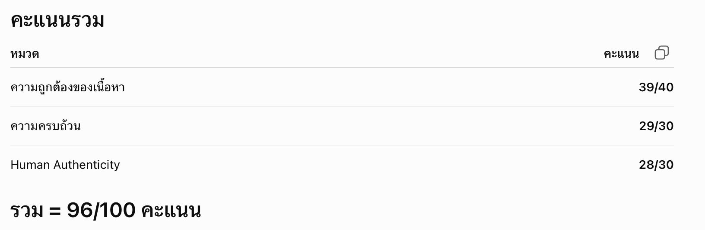
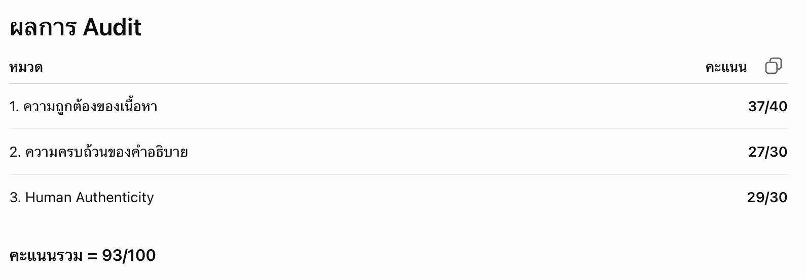
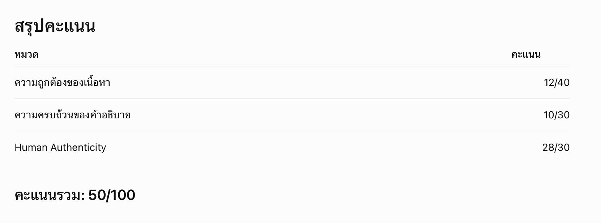

หมวด A (พื้นฐาน IoT)
ข้อ 2 IoT‑Technology
คำตอบ จากที่ศึกษาเทคโนโลยี IoT จะทำงานได้ต้องมีองค์ประกอบหลายส่วนที่ทำงานร่วมกัน ไม่ใช่แค่อุปกรณ์ที่เชื่อมต่ออินเทอร์เน็ตเท่านั้น เซนเซอร์ (Sensor) มีหน้าที่ตรวจจับข้อมูลจากสภาพแวดล้อม เช่น อุณหภูมิ ความชื้น หรือแสง แล้วส่งข้อมูลเข้าสู่ระบบ ส่วนแอคชูเอเตอร์ (Actuator) จะรับคำสั่งจากระบบเพื่อทำงาน เช่น เปิด–ปิดไฟ เปิดพัดลม หรือเปิดปั๊มน้ำ
อีกส่วนหนึ่งคือการเชื่อมต่อเครือข่าย ซึ่งทำให้อุปกรณ์สามารถส่งข้อมูลผ่าน Wi-Fi หรืออินเทอร์เน็ตไปยังเซิร์ฟเวอร์หรือแอปพลิเคชันได้ หลังจากนั้นระบบจะนำข้อมูลไปประมวลผล เพื่อวิเคราะห์และตัดสินใจว่าจะสั่งให้อุปกรณ์ทำงานหรือไม่

ตัวอย่างคือระบบรดน้ำต้นไม้อัตโนมัติ เซนเซอร์จะตรวจวัดความชื้นของดิน เมื่อพบว่าดินแห้งก็จะส่งข้อมูลผ่านเครือข่ายไปยังระบบ ระบบจะประมวลผลข้อมูลและสั่งให้แอคชูเอเตอร์เปิดปั๊มน้ำ เมื่อดินมีความชื้นเพียงพอ ระบบก็จะสั่งปิดปั๊มน้ำ ทำให้ต้นไม้ได้รับน้ำในปริมาณที่เหมาะสมโดยไม่ต้องคอยรดน้ำเอง

AI TA ตรวจและให้คะแนน

จุดที่ควรปรับปรุง
1. เพิ่มภาพรวมของ IoT อีก 1–2 ประโยค เพื่อเชื่อมโยงองค์ประกอบทั้งหมดเข้าด้วยกัน
2. กล่าวถึง Cloud หรือแอปพลิเคชันที่ใช้ติดตามหรือควบคุมอุปกรณ์ จะทำให้คำตอบสมบูรณ์ขึ้น
3. ปรับบางประโยคให้มีน้ำเสียงเป็นธรรมชาติมากขึ้น เช่น ใช้คำอย่าง "ยกตัวอย่างง่าย ๆ" หรือ "ในชีวิตจริง" แทนการอธิบายที่เป็นทางการทั้งหมด

หมวด B (Network/Protocol)
ข้อ 2 — Application Layer Technology
คำตอบ Application Layer เป็นส่วนที่ช่วยให้อุปกรณ์ IoT ส่งข้อมูลหากันได้ โดยมีโปรโตคอลหลายแบบให้เลือกใช้ตามลักษณะของงาน
MQTT เป็นโปรโตคอลที่ใช้ข้อมูลไม่มาก ส่งข้อมูลได้ค่อนข้างเร็ว จึงเหมาะกับอุปกรณ์ IoT ทั่วไป เช่น เซนเซอร์วัดอุณหภูมิหรือระบบเปิดปิดไฟในบ้าน
AMQP เป็นโปรโตคอลที่เน้นความถูกต้องของข้อมูลมากกว่า MQTT จึงเหมาะกับงานที่ข้อมูลไม่ควรหาย เช่น ระบบในโรงงานหรือระบบที่ต้องส่งข้อมูลสำคัญ
XMPP เป็นโปรโตคอลที่ใช้ส่งข้อความแบบเรียลไทม์ เดิมใช้กับระบบแชต แต่ก็สามารถนำมาใช้กับ IoT ได้ เช่น ระบบแจ้งเตือนหรือการสั่งงานอุปกรณ์จากระยะไกล
โดยรวมแล้ว MQTT จะเหมาะกับงาน IoT ทั่วไป AMQP เหมาะกับงานที่ต้องการความน่าเชื่อถือ ส่วน XMPP เหมาะกับงานที่ต้องสื่อสารกันแบบทันที

AI TA ตรวจและให้คะแนน

จุดที่ควรปรับปรุง
1. อธิบายหน้าที่ของ Application Layer ให้ชัดขึ้น เช่น ระบุว่าเป็นชั้นที่กำหนดโปรโตคอลสำหรับการสื่อสารของแอปพลิเคชันในระบบ IoT
2. เพิ่มความแตกต่างเชิงเทคนิคของแต่ละโปรโตคอลอีกเล็กน้อย เช่น MQTT ใช้รูปแบบ Publish/Subscribe, AMQP มีระบบคิวข้อความและการรับประกันการส่งข้อมูล, XMPP 
3. ใช้การสื่อสารแบบข้อความที่รองรับการโต้ตอบแบบเรียลไทม์
ปรับรูปแบบประโยคไม่ให้ซ้ำกันทุกย่อหน้า เพื่อให้การเขียนดูเป็นธรรมชาติยิ่งขึ้น

หมวด C : (System/Architecture)
ข้อ 1 — IoT System Challenges
คำตอบ การสร้างระบบ IoT มีหลายอย่างที่ต้องคำนึงถึง เพราะอาจส่งผลต่อการทำงานของอุปกรณ์
อย่างแรกคือเรื่องระยะทางในการสื่อสาร ถ้าอุปกรณ์อยู่ไกลกันมากก็ต้องเลือกเครือข่ายที่ส่งข้อมูลได้ไกล
อีกเรื่องคือ Bandwidth ถ้ามีอุปกรณ์ส่งข้อมูลพร้อมกันเยอะ ๆ อาจทำให้ระบบช้าลงได้
การใช้พลังงานก็สำคัญ เพราะอุปกรณ์หลายตัวใช้แบตเตอรี่ ถ้าใช้พลังงานมากก็ต้องเปลี่ยนแบตบ่อย
นอกจากนี้ยังมีเรื่องการเชื่อมต่อกับเครือข่าย การทำงานร่วมกับอุปกรณ์จากหลายบริษัท และเรื่องความปลอดภัยของข้อมูล ถ้าระบบป้องกันไม่ดี ข้อมูลก็อาจรั่วไหลหรือถูกโจมตีได้
ตัวอย่างเช่น ระบบรดน้ำต้นไม้อัตโนมัติ หากติดตั้งในพื้นที่กว้างก็ต้องเลือกเครือข่ายที่เหมาะสม ใช้อุปกรณ์ที่ประหยัดพลังงาน และมีการป้องกันข้อมูล เพื่อให้ระบบทำงานได้อย่างต่อเนื่อง

AI TA ตรวจและให้คะแนน

จุดที่ควรปรับปรุง
1. ตอบให้ตรงคำถามมากขึ้น (สำคัญที่สุด)
คำถามถามว่า IoT คืออะไร แต่คำตอบอธิบายเรื่อง ปัจจัยในการออกแบบระบบ IoT แทน จึงควรเริ่มต้นด้วยนิยามของ IoT ก่อน
2. เพิ่มนิยามของ IoT
ควรอธิบายว่า IoT คือการที่อุปกรณ์ต่าง ๆ เชื่อมต่ออินเทอร์เน็ต สามารถรับส่งข้อมูล และทำงานร่วมกันได้โดยอัตโนมัติหรือสามารถควบคุมจากระยะไกล
3. อธิบายเหตุผลว่าทำไมตัวอย่างจึงเป็น IoT
แม้จะยกตัวอย่าง "ระบบรดน้ำต้นไม้อัตโนมัติ" ได้ถูกต้อง แต่ยังไม่ได้อธิบายว่าระบบนี้เป็น IoT เพราะมีเซนเซอร์เก็บข้อมูล ส่งข้อมูลผ่านเครือข่าย และสั่งการอุปกรณ์อัตโนมัติ
4. แสดงความเข้าใจการทำงานของระบบ
ควรอธิบายลำดับการทำงานสั้น ๆ เช่น
เซนเซอร์วัดความชื้นในดิน → ส่งข้อมูลผ่านอินเทอร์เน็ต → ระบบประมวลผล → สั่งเปิดหรือปิดปั๊มน้ำ
จะช่วยให้เห็นความเข้าใจเชิงระบบมากขึ้น
5. ลดรายละเอียดที่ไม่เกี่ยวข้องกับคำถาม
เนื้อหาเรื่อง Bandwidth, ระยะทางการสื่อสาร, การใช้พลังงาน และความปลอดภัย เป็นข้อมูลที่ถูกต้อง แต่ไม่ใช่สิ่งที่คำถามนี้ต้องการ จึงควรตัดออกหรือกล่าวเพียงเล็กน้อย เพื่อให้มีพื้นที่อธิบายประเด็นหลักได้ครบถ้วน
